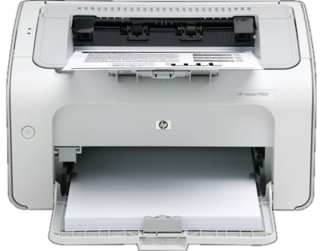

<div align="center">



# HP LaserJet P1005 for Android

An Android app that prints documents and photos straight to an HP LaserJet P1005 over USB OTG. No computer and no network needed.

</div>

> This repository holds recovered source, not a verified latest version. See `RECOVERY-STATUS.md`. A reconstruction of the shipped APK 1.1 is on the `reverse-engineered-v1.1` branch. Arabic README: [README.ar.md](README.ar.md).

---

## Features

| Feature | Description |
| --- | --- |
| Print documents | Print PDF files directly on the printer |
| Print photos | Convert photos and print them in black and white |
| Receive from other apps | Accept files from any app through the Share menu |
| Print queue | Follow running and waiting jobs, plus a print history |
| Print options | Copies, page range, paper size, page layout, quality, and manual two-sided printing |
| Printer setup | A setup wizard checks the firmware and prints a test page |
| Printer maintenance | Check the firmware version (FWVER) and load it when needed |
| Diagnostics log | USB and print log for troubleshooting |
| Arabic interface | Full Arabic UI in a One UI style, dark and light, for phone and tablet |

## Requirements

- An Android device with USB OTG support, and an OTG cable or adapter.
- An HP LaserJet P1005 connected directly to the device.

## How to use

1. Turn the printer on and connect it to the device over USB OTG.
2. Open the app, tap **Printer setup**, and follow the steps until the test page prints.
3. Choose **Print document** or **Print photos**, or share a file to the app from anywhere.
4. Set the print options, then tap **Print**.

> **Important:** the P1005 loses its firmware every time it loses power. After you switch it on again, load the firmware once from the maintenance page before printing. Do not reload it without a reason.

## Known limits

- Only the HP LaserJet P1005 is supported, in monochrome only.
- Printing works over wired USB OTG only. There is no network or wireless printing.
- Two-sided printing is manual (flip the paper and feed it again).

## Build

```bash
./gradlew assembleRelease
```

## Protocol and licence

The printer uses the proprietary XQX protocol, so plain text or raw images cannot be sent directly. The app converts pages internally with the `foo2xqx` generator from the OpenPrinting project. Check its source licence notices before redistributing any part of it: https://github.com/OpenPrinting/foo2zjs

---

<div align="center">

brought to you by <b>Instinct</b>

</div>
